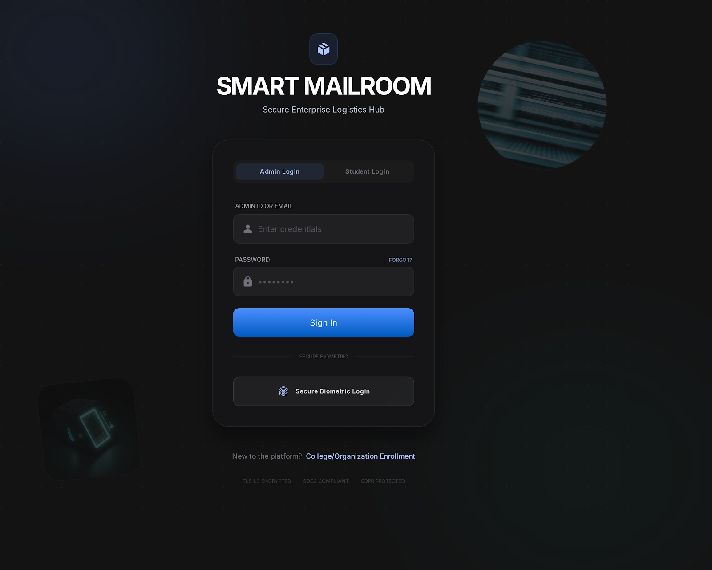
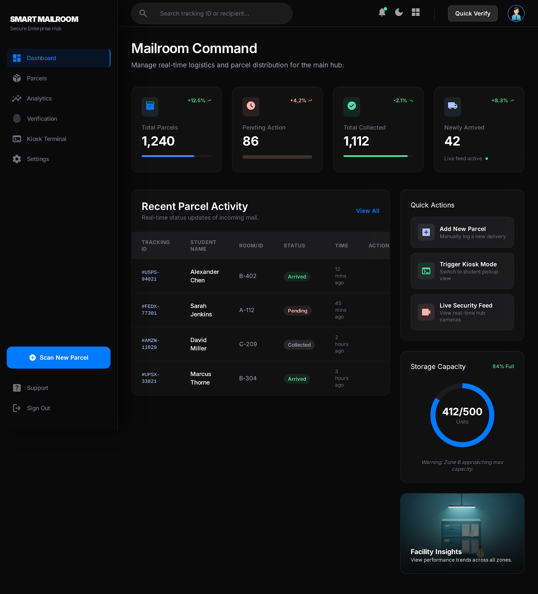
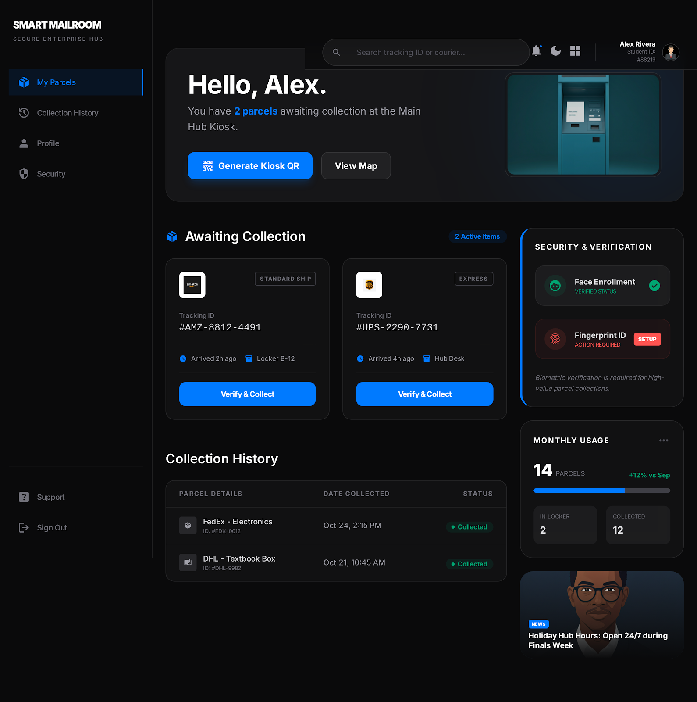
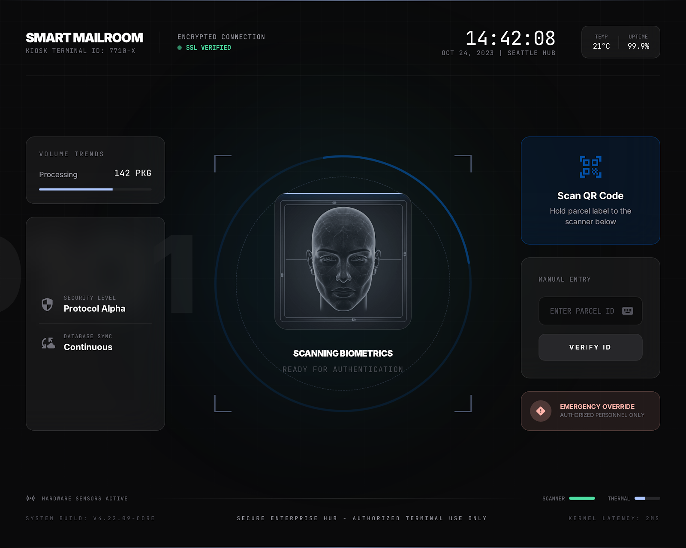
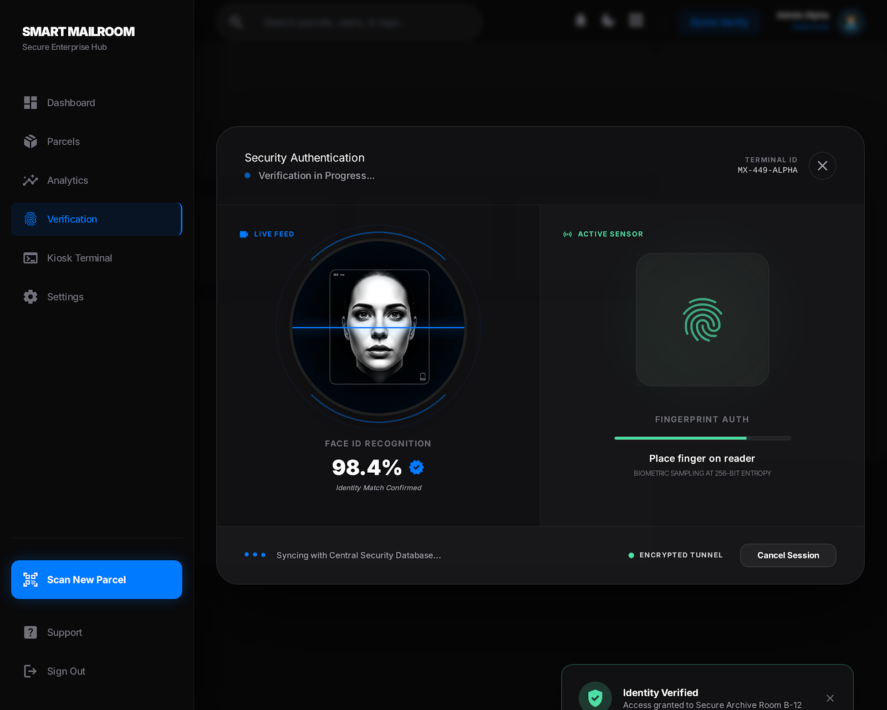
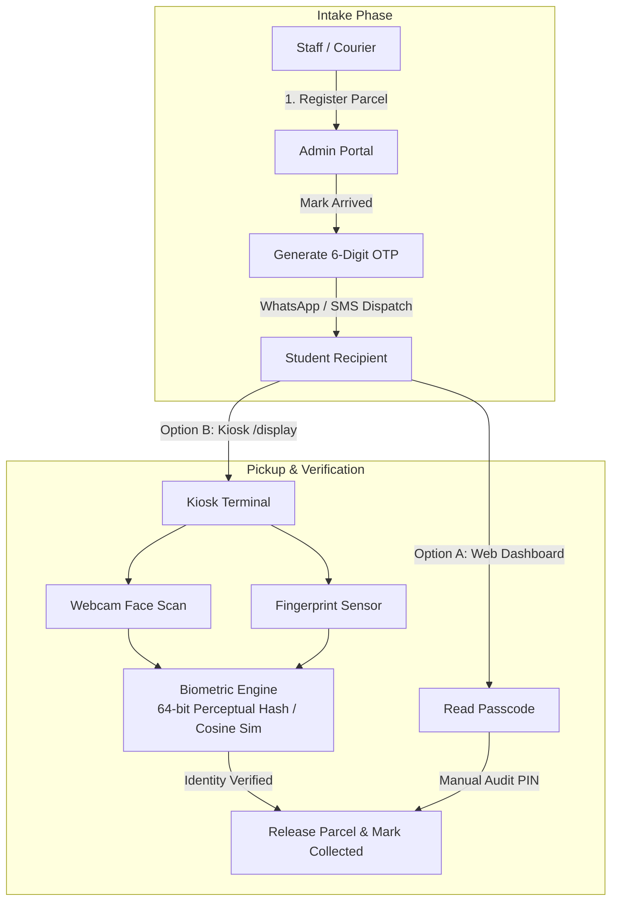

<div align="center">

# 📦 Smart Mailroom System
### Automated Campus & Enterprise Parcel Hub with Dual-Factor Biometric Verification

[](https://fastapi.tiangolo.com)
[](https://www.python.org/)
[](https://tailwindcss.com/)
[](https://www.sqlite.org/)
[](LICENSE)

An intelligent, secure, and touchless logistics management platform designed to automate parcel intake, notifications, and pickups with **Dual-Factor Biometrics (Facial Verification + Hardware Fingerprint ID)** and expiring **6-digit OTP codes**.

[Key Features](#-key-features) • [UI Showcase](#-ui-showcase) • [Architecture](#-system-architecture) • [Getting Started](#-getting-started) • [Default Credentials](#-default-credentials)

---

</div>

## 📸 UI Showcase

### 1. Unified Authentication Portal
> Role-switched login supporting traditional credentials or instant **Secure Biometric Login** via enrolled fingerprint sensors.

<div align="center">
  
</div>

---

### 2. Admin Command Center
> Real-time logistics telemetry, hub capacity monitoring, manual delivery intake, arrival state changes, and automated OTP dispatching.

<div align="center">
  
</div>

---

### 3. Student Self-Service Dashboard
> Live tracking of incoming deliveries, active locker locations, 6-digit pickup passcodes, collection history, and biometric security enrollment status.

<div align="center">
  
</div>

---

### 4. Smart Kiosk Terminal Mode (`/display`)
> Interactive kiosk UI built for self-service pickup stations with live camera feed, hardware sensor telemetry, and barcode/QR verification.

<div align="center">
  
</div>

---

### 5. Dual-Factor Biometric Verification
> Real-time webcam face capture cross-referenced with a 64-bit perceptual hash + fingerprint PIN authorization to automatically release packages.

<div align="center">
  
</div>

---

## ✨ Key Features

- **🛡️ Dual-Factor Biometric Security**:
  - **Facial Verification**: Real-time webcam frame capture with dlib embeddings or an automatic 64-bit perceptual hashing fallback (`Pillow`) for zero-dependency native execution.
  - **Fingerprint Verification**: Authenticates enrolled hardware fingerprint sensor IDs or student security PINs.
- **📱 Automated Lifecycle & OTP Passcodes**:
  - Parcels transition seamlessly: `Pending` (In Transit) $\rightarrow$ `Arrived` $\rightarrow$ `Collected`.
  - On arrival, an expiring 6-digit OTP is generated and dispatched via Twilio WhatsApp / terminal fallback logging.
- **🖥️ Standalone Kiosk Mode (`/display`)**:
  - Fullscreen terminal mode for automated parcel pickup lockers.
  - Automatic identification and instantaneous locker release upon verification.
- **📊 Real-time Logistics Telemetry**:
  - Hub slot utilization gauges, arrival rate metrics, and historical collection audits.
- **🧪 Built-in Guided Demo & Dev Mode**:
  - Interactive walkthrough tour and DEV toggle pill to simulate sensor touches, auto-generate demo parcels, and test hardware bypasses.

---

## 🏗️ System Architecture



---

## 🚀 Getting Started

### Prerequisites
- Python 3.10+
- Webcam (for biometric facial verification)

### 1. Clone the Repository
```bash
git clone https://github.com/macmilan-labs/smart-mailroom-system.git
cd smart-mailroom-system/mailroom_system
```

### 2. Set Up Virtual Environment
```bash
# Windows
python -m venv venv
.\venv\Scripts\activate

# macOS / Linux
python3 -m venv venv
source venv/bin/activate
```

### 3. Install Dependencies
```bash
pip install -r requirements.txt
```

### 4. Run the Application
```bash
python -m uvicorn main:app --reload --port 8000
```
Open **[http://127.0.0.1:8000](http://127.0.0.1:8000)** in your web browser.

---

## 🔑 Default Credentials

Click **"Initialize Test Data"** on the login screen, or use the pre-configured accounts:

| Role | Username | Password | Enrolled Fingerprint ID |
| :--- | :--- | :--- | :--- |
| **Administrator** | `admin` | `admin` | `admin_fingerprint` |
| **Student** | `student1` | `password` | `student_fingerprint` |

> 💡 **Quick Login**: Use the tab switcher or the **"Secure Biometric Login"** button on the sign-in card.

---

## 📁 Repository Structure

```text
smart-mailroom-system/
├── docs/
│   └── screenshots/              # UI preview assets for README
├── mailroom_system/
│   ├── static/
│   │   ├── css/style.css         # Custom dark theme and animations
│   │   └── js/app.js             # Biometric terminal, OTP & modal handlers
│   ├── templates/
│   │   ├── admin_dash.html       # Logistics operations center
│   │   ├── base.html             # Common layout, top navigation & Dev mode
│   │   ├── display.html          # Interactive kiosk pickup terminal
│   │   ├── login.html            # Unified biometric/credential login
│   │   └── student_dash.html     # Student deliveries and security context
│   ├── auth.py                   # Password hashing & verification (bcrypt)
│   ├── biometric_service.py      # Face embedding & perceptual-hash algorithms
│   ├── crud.py                   # SQLAlchemy database operations
│   ├── database.py               # SQLite engine & lightweight auto-migrations
│   ├── logger.py                 # Structured system logging
│   ├── main.py                   # FastAPI web & REST API endpoints
│   ├── mfa_services.py           # Twilio WhatsApp OTP notifications
│   ├── models.py                 # User, Parcel, and OTPLog database models
│   ├── schemas.py                # Pydantic validation models
│   └── requirements.txt          # Python package requirements
├── .gitignore
└── README.md
```

---

## 📄 License
This project is open-source and available under the [MIT License](LICENSE).
